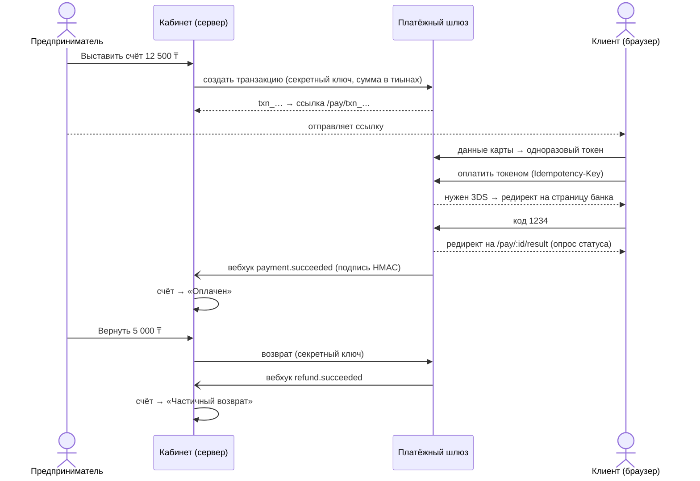

# Платежи и эквайринг в кабинете

## Что изменилось

Раньше «Выставить платёж» сразу создавал платёж со статусом «Оплачен», а «Вернуть» просто менял статус.
Теперь как в жизни:

1. Предприниматель выставляет счёт → статус **«Ожидает оплаты»** + ссылка для клиента.
2. Клиент открывает ссылку `/pay/:id` (без входа в кабинет) и платит: **картой, Google Pay, Apple Pay или кошельком**.
3. Если банк требует — **3-D Secure** (страница банка, код из SMS).
4. Платёжный шлюз присылает кабинету **вебхук** → статус становится «Оплачен».
5. «Вернуть» отправляет **возврат через шлюз** (можно часть суммы) → вебхук → «Частичный возврат» / «Возвращён».

## Три участника

В жизни это три разные системы. Здесь они в одном проекте, но общаются **только через HTTP**:

| Участник | Где в коде | Что делает |
|---|---|---|
| Кабинет (сервер) | `app/api/payments/*`, `app/api/webhooks/*`, `mocks/db.ts`, `mocks/webhookHandler.ts` | Счета, возвраты, приём вебхуков |
| Платёжный шлюз (эквайер) | `app/api/gateway/*`, `mocks/gateway/*` | Токенизация карт, списание, 3DS, вебхуки, возвраты |
| Браузер клиента | `views/checkout`, `features/pay-by-*` | Форма оплаты, выполнение редиректов, показ статуса |



## Как проверить (5 минут)

1. Войти `shop@test.com` / `shop123` → «Новый платёж» → выставить счёт → открыть «Ссылка на оплату».
2. Карта `4000 0000 0000 3220`, срок `12/28`, CVV `123`, имя `IVAN PETROV` → код `1234` → «Оплата прошла».
3. «Платежи» — счёт стал «Оплачен», видна карта •••• 3220. Это сделал вебхук, а не браузер клиента.
4. Войти админом `admin@test.com` / `admin123` → «Вебхуки» → включить «Эмулировать падение».
   Сделать частичный возврат — в журнале видны ответы 503 и повторы, статус счёта пока не меняется.
   Выключить галочку — следующий повтор получит 200, статус станет «Частичный возврат».
5. Новый счёт → Google Pay → `VISA •••• 0002` (отказ) → в кабинете «Ошибка оплаты» →
   клиент жмёт «Попробовать снова» → «Электронный кошелёк» → «Подтвердить» → «Оплачен».

Тестовые карты показаны на странице оплаты (жёлтый блок «Тестовые карты»).

| Карта | Результат |
|---|---|
| 4242 4242 4242 4242 | Успех |
| 4000 0000 0000 3220 | 3-D Secure, код `1234` |
| 4000 0000 0000 0002 | Отказ банка |
| 4000 0000 0000 9995 | Недостаточно средств |
| 4000 0000 0000 9979 | Украденная карта — клиент видит только общий отказ |
| 4000 0000 0000 0077 | Долгая обработка (~4 сек) |
| 4000 0000 0000 0119 | Банк не ответил один раз — фронтенд сам повторяет запрос |

## Почему сделано так

| Решение | Зачем |
|---|---|
| Статус счёта меняется только по вебхуку | Клиент может закрыть вкладку до возврата на сайт; браузеру клиента верить нельзя |
| Экран результата спрашивает статус у шлюза | `?status=success` в адресе может подделать кто угодно |
| Карта → токен в шлюзе, дальше только токен | Кабинет не видит номер карты и не попадает под тяжёлые требования PCI DSS |
| CVV нигде не хранится | Запрещено PCI DSS |
| Проверка карты и на фронте, и в шлюзе | Фронт — для удобства, сервер — для безопасности |
| Создание транзакции и возврат — только с секретным ключом с сервера | Иначе любой мог бы создать счёт на 1 тиын или вернуть себе деньги |
| Шлюз работает в тиынах (целых числах) | `0.1 + 0.2 !== 0.3` в JavaScript |
| `Idempotency-Key` на оплату и возврат | Повтор после обрыва сети не спишет и не вернёт деньги дважды |
| Подпись вебхука HMAC + время | Иначе любой мог бы прислать «payment.succeeded» |
| Кабинет отбрасывает повторные вебхуки по `event.id` и не откатывает статус назад | Шлюз доставляет «как минимум один раз» и не гарантирует порядок |
| Следующий шаг (3DS, кошелёк) решает шлюз (`nextAction`) | Фронтенд не знает правил банка, он только выполняет |
| Ошибки клиенту — понятным текстом, без сырых кодов банка | «Карта украдена» — подсказка мошеннику |

## UX формы карты (задание первой недели)

- **Номер группами по 4** — так он напечатан на карте, легко сверить и заметить пропуск.
- **CVV скрыт, но не `type="password"`** — иначе браузер предложит «сохранить пароль», а телефон откроет буквенную
  клавиатуру. Поле обычное (`inputMode="numeric"`, `autocomplete="cc-csc"`), скрытие — CSS `-webkit-text-security`.
- **Автопереход** — у полей фиксированная длина; переход только если поле верное, иначе фокус остаётся на ошибке.

## Что эмулируется

- **Google Pay** — запрос `PaymentDataRequest` собран по документации; окно выбора карты — эмуляция
  (для настоящего нужен `pay.js`, Google-аккаунт, в продакшене — регистрация продавца).
- **Apple Pay** — запрос `ApplePayPaymentRequest` по документации, доступность проверяется по-настоящему
  (`ApplePaySession.canMakePayments()`); окно — эмуляция (нужен Safari, подтверждённый домен и сертификат продавца).
- **3DS и кошелёк** — страницы «банка» и «провайдера» внутри проекта; в жизни это чужие сайты.
- Данные хранятся в памяти и сбрасываются при перезапуске.

## Где что лежит (FSD)

```
entities/card          Луна, маски, валидация карты
entities/transaction   платёж глазами шлюза: статусы, ошибки, попытка оплаты
entities/payment       счёт кабинета: новые статусы, ссылка на оплату
entities/webhook       событие и журнал доставки
features/pay-by-card, pay-by-google-pay, pay-by-apple-pay, pay-by-wallet
features/select-payment-method, confirm-3ds, confirm-wallet, track-payment-status
features/refund-payment (частичный возврат), simulate-webhook-outage
widgets/payment-methods, payment-summary, payment-status, webhook-log, sandbox-hint
views/checkout, three-ds, wallet, payment-result, webhooks
mocks/gateway/*        мок-шлюз;  mocks/webhookHandler.ts — приём вебхуков кабинетом
```

Тесты: `npm test` — Луна и валидация карты, сценарии шлюза, обработка вебхуков, подпись, идемпотентность.
